<div align="center">

# Hi there, I'm Rahul Singh 👋
### ⚡ Senior Cloud & DevSecOps Architect ⚡
**5+ Years of Production Experience across Azure & AWS Enterprise Ecosystems**

[;FinOps+Strategist+%7C+28%25%2B+Cloud+Cost+Optimization)](https://git.io/typing-svg)

<br/>

<p align="center">
  <a href="https://linkedin.com/in/rahulent" target="_blank">
    
  </a>
  <a href="mailto:rahulsingh.clouddevops@gmail.com">
    
  </a>
  <a href="https://github.com/rahulent">
    
  </a>
</p>

</div>

---

## 🚀 Quick Snapshot

```
┌───────────────────────────┬────────────────────────────────────────────────────────┐
│ Metric / Domain           │ Enterprise Track Record                                │
├───────────────────────────┼────────────────────────────────────────────────────────┤
│ 🏆 Experience             │ 5+ Years in Enterprise Cloud & DevSecOps Architecture  │
│ ☁️ Core Ecosystems        │ Microsoft Azure (Primary) & Amazon Web Services (AWS)  │
│ 🏢 Workload Migrations    │ 100+ Enterprise Apps Migrated (Dev, UAT, Multi-AZ Prod)│
│ 🛡️ Security Posture       │ Zero-Trust, CIS Benchmark, Shift-Left Policy-as-Code  │
│ 💰 FinOps Impact          │ 28%+ Annual Cost Reduction via Waste Purging & Rightsizing│
│ 📈 Availability SLA       │ Engineered Active-Active Multi-Zone Resiliency (99.99%)│
└───────────────────────────┴────────────────────────────────────────────────────────┘
```

---

## 👨‍💻 Executive Summary

I am a **Senior Cloud & DevSecOps Architect** specializing in architecting resilient, automated, and mathematically governed cloud infrastructure. I bridge the gap between **business objectives, cloud architecture, and ironclad security**.

* 🌐 **Landing Zone Architecture:** Implementing enterprise **Microsoft Cloud Adoption Framework (CAF)** hierarchies with sovereign subscription boundaries (`Platform`, `Corp`, `Online`, `Sandbox`).
* 🔒 **Zero-Trust Networking:** Engineering hub-and-spoke networks with centralized firewall inspection, forced tunneling (`0.0.0.0/0`), and private PaaS connectivity via **Azure Private Link**.
* ⚙️ **Automated DevSecOps:** Embedding automated vulnerability detection, secret hunting, and cost governance directly into CI/CD pipelines before any code hits production.
* 📦 **Cloud Migration & Modernization:** Spearheading end-to-end cloud adoption from discovery and TCO assessment to cutover and hypercare war room operations.

---

## 🛠️ Tech Stack & Arsenal

<div align="center">

<!-- Visual Modern Skill Icons -->
<a href="https://skillicons.dev">
  
</a>

<br/><br/>

| Domain | Core Tooling & Technologies |
| :--- | :--- |
| **Cloud Platforms** | **Microsoft Azure** (Landing Zones, Entra ID, AKS, Virtual Networks, Key Vault) • **AWS** (EC2, S3, IAM, VPC, EKS) |
| **Infrastructure as Code** | **Terraform** (Reusable Modules, State Locking) • **Terragrunt** • **Azure Bicep** • **Ansible** |
| **Containers & Orchestration** | **Kubernetes (AKS / EKS)** • **Docker** • **Helm** • **ArgoCD (GitOps)** • **KEDA** |
| **DevSecOps & Shift-Left** | **GitLeaks** • **Trivy** • **Checkov** • **tfsec** • **SonarQube** • **Microsoft Defender for Cloud** |
| **CI / CD Automation** | **Azure DevOps Pipelines** (YAML Templates, Multi-Stage) • **GitHub Actions** • **GitLab CI** |
| **FinOps & Cloud Economics** | **Infracost** • **Azure Cost Management** • **AWS Cost Explorer** • **Savings Plans & RIs** |
| **Observability & Monitoring** | **Azure Monitor** • **Log Analytics (DCR)** • **Prometheus** • **Grafana** • **Alert Action Groups** |
| **Scripting & Automation** | **Bash** • **PowerShell** • **Python** • **YAML / JSON** |

</div>

---

## 🔄 End-to-End DevSecOps Delivery Architecture

Every infrastructure change and application commit passes through a rigorous shift-left automated pipeline:

```mermaid
flowchart LR
    A["👨‍💻 Git Commit & PR"] --> B["🔍 Lint & Format<br/>(tflint / fmt)"]
    B --> C["🔐 Secret Scan<br/>(GitLeaks)"]
    C --> D["🛡️ IaC Security<br/>(Checkov / Trivy)"]
    D --> E["💰 FinOps Gate<br/>(Infracost)"]
    E --> F["👥 Senior Approval<br/>(2+ Reviewers)"]
    F --> G["🚀 Terraform Apply<br/>(Blob Lease Lock)"]
    G --> H["📊 Nightly Drift Check<br/>& Continuous Telemetry"]

    classDef stage fill:#0d1117,stroke:#38bdf8,stroke-width:2px,color:#e2e8f0;
    class A,B,C,D,E,F,G,H stage;
```



> **Automated Pipeline Highlights:**
> 1. **Zero Secret Leakage:** GitLeaks prevents accidental credential exposure at commit time.
> 2. **Policy-as-Code:** Checkov and Trivy validate IaC configurations against CIS and NIST baselines before review.
> 3. **FinOps Visibility:** Infracost posts automated monthly cost impact diffs directly into the Pull Request.
> 4. **State Integrity:** Remote Terraform state is secured in private Blob storage with blob lease locking and OIDC authentication.
> 5. **Nightly Drift Detection:** Scheduled cron pipelines identify unauthorized manual console modifications instantly.

---

## 🏛️ Signature Architectural Blueprints

<details open>
<summary><b>1. Enterprise Hub-and-Spoke Network with Zero-Trust Isolation</b></summary>
<br/>

* **Hybrid Connectivity:** High-speed ExpressRoute with redundant S2S VPN failover linking on-prem to Azure Hub.
* **Central Traffic Inspection:** User Defined Routes (UDRs) funneling all inter-spoke and egress traffic (`0.0.0.0/0`) through Azure Firewall Premium with TLS inspection and IDPS.
* **100% Private PaaS:** Zero public IP exposure. All data services (Azure Key Vault, Storage Accounts, SQL Databases) communicate strictly via **Azure Private Endpoints** and central **Private DNS Zones**.
* **Micro-Segmentation:** Network Security Groups (NSGs) and Application Security Groups (ASGs) preventing lateral movement across subnets.

</details>

<details open>
<summary><b>2. 100+ Enterprise Workload Cloud Migration Framework</b></summary>
<br/>

* **Discovery & Sizing:** Automated inventory, dependency mapping, and 7 R's classification using Azure Migrate.
* **Landing Zone Foundation:** Automated provisioning of CAF-compliant Landing Zones with subscription isolation (`Corp`, `Online`, `Dev`, `UAT`, `Prod`).
* **Cutover with Zero Downtime:** Continuous database replication, low-TTL DNS cutover during maintenance windows, and automated smoke test validation.
* **Hypercare:** Dedicated 24x7 War Room telemetry monitoring and operational runbook handoff.

</details>

<details open>
<summary><b>3. Enterprise FinOps & Cloud Economics Playbook</b></summary>
<br/>

* **Waste Eradication:** Automated serverless routines deleting unattached managed disks, obsolete snapshots, and unassociated public IPs.
* **Non-Prod Auto-Shutdown:** Scheduled start/stop routines for Dev and UAT workloads, reducing non-prod compute spend by ~65%.
* **Commitment Structuring:** Balancing on-demand capacity with 1-Year / 3-Year Reserved Instances (RIs) and Azure Savings Plans.
* **Log Ingestion Tuning:** Configuring Data Collection Rules (DCR) to suppress noisy audit logs, saving 30%+ on Log Analytics storage.

</details>

---

## 💡 Core Engineering Principles

```
  [ Shift-Left by Default ]      Catch security and cost anomalies in code, never in production.
  [ Immutable Infrastructure ]   Never patch running instances; rebuild and redeploy through IaC.
  [ Blast Radius Isolation ]     Strict subscription and network boundaries to prevent cascading failures.
  [ FinOps as a Priority ]       Every architecture decision must justify its cloud spend and ROI.
```

---

## 📊 Live GitHub Telemetry

<div align="center">


<br/>


</div>

---

## 📫 Let's Connect

Whether it's discussing enterprise cloud migrations, zero-trust architectures, or DevSecOps transformation:

<div align="center">

<a href="https://linkedin.com/in/rahulent">
  
</a>
&nbsp;&nbsp;
<a href="mailto:rahulsingh.clouddevops@gmail.com">
  
</a>
&nbsp;&nbsp;
<a href="https://github.com/rahulent">
  
</a>

<br/><br/>

```
[SYSTEM STATUS] :: 99.99% UPTIME | ZERO-TRUST ENFORCED | FINOPS OPTIMIZED
"Security and resilience are not features; they are foundational code."
```

</div>
