<div align="center">

# ⚡ Rahul Singh ⚡
### **Lead Cloud & DevSecOps Architect**
**10+ Years in Enterprise IT • 5+ Years in Cloud, DevOps & Security Architecture**

[;Migrated+100%2B+Production+Workloads+with+Zero+Downtime;Production-Grade+IaC%2C+Terraform+Modules+%26+FinOps;Securing+Cloud+Ecosystems+with+Shift-Left+Automation)](https://git.io/typing-svg)

<br/>

[](#)
[](#)
[](#)
[](#)
[](#)

<br/><br/>

<a href="https://linkedin.com/in/rahulent" target="_blank">
  
</a>
&nbsp;&nbsp;
<a href="mailto:rahulsingh.clouddevops@gmail.com">
  
</a>
&nbsp;&nbsp;
<a href="https://github.com/rahulent">
  
</a>

</div>

---

## 👨‍💻 The 10+ Year IT Journey to Cloud & DevSecOps

With over **10+ years of deep enterprise IT experience**—evolving from core infrastructure, networking, and datacenter operations into **5+ years of cutting-edge Cloud Architecture and DevSecOps**—I bring a battle-tested understanding of both traditional infrastructure and modern autonomous cloud platforms.

I specialize in designing, securing, and scaling mission-critical workloads across **Microsoft Azure and AWS**, backed by mathematically audited reliability and automated governance:

* 🏢 **100+ Enterprise Workload Migrations:** Led full lifecycle datacenter-to-cloud cutovers across Dev, UAT, and Multi-Zone Production tiers with zero data loss.
* 🌐 **Enterprise Landing Zones (CAF):** Built enterprise-grade Azure Cloud Adoption Framework (CAF) hierarchies with sovereign subscription separation, Management Group policies, and CIS benchmarks.
* 🛡️ **Zero-Trust & Shift-Left DevSecOps:** Embedded automated secret scanning, IaC vulnerability gates, and Policy-as-Code directly into developer pull requests.
* 🔌 **Zero-Trust Hub-and-Spoke Networking:** Designed hybrid connectivity with ExpressRoute, Azure Firewall Premium with TLS inspection, UDR forced tunneling, and 100% Private Endpoints.
* 💰 **FinOps & Cloud Economics:** Slashed enterprise cloud bills by **28%+** through rightsizing, automated non-prod lifecycle management, and reserved capacity planning.

---

## 🛠️ The Tech Arsenal

<div align="center">

<a href="https://skillicons.dev">
  
</a>

</div>

<br/>

### ☁️ Cloud & Infrastructure as Code
* **Cloud Platforms:** Microsoft Azure (Primary), Amazon Web Services (AWS), Hybrid Cloud
* **IaC & Automation:** Terraform (Modular Architecture, State Locking, OIDC), Terragrunt, Azure Bicep, ARM Templates, Ansible
* **Containerization & Orchestration:** Kubernetes (AKS / EKS), Docker, Helm, ArgoCD (GitOps), KEDA

### 🛡️ DevSecOps & Security Engineering
* **Shift-Left Security:** GitLeaks, Checkov, Trivy, tfsec, SonarQube, Snyk
* **Identity & Governance:** Microsoft Entra ID, Privileged Identity Management (PIM / JIT Access), Azure Policy, RBAC
* **Cloud Defense:** Microsoft Defender for Cloud, Azure Firewall Premium, NSGs/ASGs, Customer-Managed Keys (CMK)

### 🚀 CI/CD, Observability & FinOps
* **CI/CD Pipelines:** Azure DevOps Pipelines (Multi-stage YAML), GitHub Actions, GitLab CI, Jenkins
* **Monitoring & Observability:** Azure Monitor, Log Analytics (DCR Filtering), Prometheus, Grafana, Alert Action Groups
* **FinOps Tooling:** Infracost (PR Cost Gates), Azure Cost Management, AWS Cost Explorer, Savings Plans & RIs
* **Scripting & Tooling:** Python, Bash, PowerShell, Git, Linux / Unix Internals

---

## 🔄 Automated Shift-Left DevSecOps Pipeline

Every commit and infrastructure Pull Request is automatically vetted for security, compliance, cost, and stability before reaching production:

```mermaid
flowchart LR
    A["💻 Git Commit & PR"] --> B["🔍 Linting & Syntax<br/>(tflint / fmt)"]
    B --> C["🔐 Secret Detection<br/>(GitLeaks)"]
    C --> D["🛡️ IaC Security Gates<br/>(Checkov / Trivy)"]
    D --> E["💰 FinOps Cost Check<br/>(Infracost)"]
    E --> F["👥 Senior Approvals<br/>(2+ Reviewers)"]
    F --> G["🚀 Terraform Apply<br/>(Blob Lease Lock)"]
    G --> H["📊 Nightly Drift CI<br/>& Azure Telemetry"]

    classDef stage fill:#0d1117,stroke:#00F0FF,stroke-width:2px,color:#ffffff;
    class A,B,C,D,E,F,G,H stage;
```



---

## 🏛️ Proven Enterprise Architectural Solutions

### 1. Enterprise Hub-and-Spoke Network Architecture
* **Hybrid Connectivity:** High-availability ExpressRoute with redundant Site-to-Site (S2S) VPN failover.
* **Central Traffic Inspection:** User Defined Routes (UDRs) funneling `0.0.0.0/0` and all inter-spoke traffic through Azure Firewall Premium with deep TLS inspection and IDPS.
* **100% Private PaaS Services:** Zero public IP exposure. All data services (Key Vault, Storage Accounts, SQL Databases) communicate strictly via Azure Private Endpoints and Central Private DNS Zones.
* **Micro-Segmentation:** Granular NSGs and Application Security Groups (ASGs) preventing lateral network traversal.

### 2. 100+ Enterprise Workload Migration Framework
* **Discovery & TCO Assessment:** Automated inventory, dependency mapping, and 7 R's strategy using Azure Migrate.
* **Landing Zone Provisioning:** Automated deployment of CAF-compliant Landing Zones with subscription isolation (`Platform`, `Corp`, `Online`, `Dev`, `UAT`, `Prod`).
* **Zero-Downtime Cutover:** Staged data replication, low-TTL DNS failover during maintenance windows, and automated smoke testing.
* **Hypercare:** 24x7 War Room telemetry monitoring and operational runbook handoff.

### 3. Enterprise FinOps & Cost Engineering
* **Automated Waste Elimination:** Serverless cleanup routines purging unattached managed disks, obsolete snapshots, and idle public IPs.
* **Non-Prod Auto-Shutdown:** Scheduled automation powering off Dev and UAT environments outside business hours, saving ~65% on non-prod compute.
* **Commitment Architecture:** Structured mix of 1-Year and 3-Year Reserved Instances (RIs) and Azure Savings Plans covering steady-state baselines.
* **Log Ingestion Tuning:** Configured Data Collection Rules (DCR) in Azure Monitor to suppress noisy audit logs, cutting ingestion bills by 30%+.

---

## 💡 The Core Engineering Tenets

* **Shift-Left Security:** Security is never an afterthought; catch secrets and misconfigurations in code, not during a production breach.
* **Immutable Infrastructure:** Never patch running servers; tear down and redeploy through version-controlled IaC.
* **Blast Radius Containment:** Isolate environments by subscription and network boundaries to prevent cascading failures.
* **FinOps by Design:** Every architecture decision must justify its cloud spend and deliver measurable business ROI.

---

## 📊 Live GitHub Telemetry

<div align="center">


<br/>


</div>

---

## 📫 Let's Connect & Collaborate

Whether you're planning large-scale cloud migrations, designing zero-trust landing zones, or automating DevSecOps pipelines:

<div align="center">

<a href="https://linkedin.com/in/rahulent">
  
</a>
&nbsp;&nbsp;
<a href="mailto:rahulsingh.clouddevops@gmail.com">
  
</a>
&nbsp;&nbsp;
<a href="https://github.com/rahulent">
  
</a>

<br/><br/>

```
[SYSTEM STATUS] :: 99.99% PRODUCTION SLA | ZERO-TRUST ENFORCED | FINOPS OPTIMIZED
"Resilience and security are not features—they are foundational code."
```

</div>
